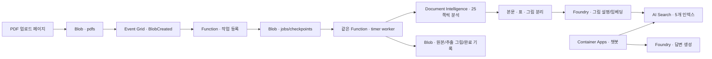

# 고객용 Azure 컴포넌트 조합 데모

이 레포는 **Azure 서비스들을 조합하는 방법을 직접 배포하고 살펴보는 참고 예제**입니다. Production 운영 플랫폼이나 고객 데이터 보안의 완성형 템플릿은 아닙니다.

## 1. 보여주는 조합



| 컴포넌트 | 이 예제에서 확인하는 내용 |
|---|---|
| Blob Storage | 원본 `pdfs`와 처리 결과 `document-assets`를 분리하여 재귀 이벤트 방지 |
| Event Grid | BlobCreated 이벤트를 Function에 전달 |
| Azure Functions | 이벤트는 작업만 저장하고 즉시 응답. timer worker가 짧은 단계별 처리를 실행 |
| Document Intelligence | 본문·표·그림의 레이아웃 추출, 원본 페이지 번호 유지 |
| Microsoft Foundry | 그림 설명, 3072차원 임베딩, 에이전트의 답변 생성 |
| Azure AI Search | 본문·표·그림 인덱스 3개 + 기존 기금 후처리 인덱스 2개 |
| Container Apps / ACR | 챗봇 컨테이너 이미지 빌드·실행, WebSocket 스트리밍 |
| API 키 / 앱 비밀 참조 | Contributor만으로 연결할 수 있는 데모 인증. 키는 Azure 앱 설정·비밀에 보관 |
| Application Insights | Function의 처리 단계·오류와 에이전트 trace |

원본은 한 개의 PDF로 보존하고 내부에서 25쪽씩 분석합니다. 페이지·그림·업로드 배치 체크포인트가 Blob에 저장되어 중단 지점부터 재개합니다. 별도 Queue 서비스는 만들지 않습니다.

## 2. 사전 준비

- Git, [Azure CLI](https://learn.microsoft.com/cli/azure/install-azure-cli), [uv](https://docs.astral.sh/uv/getting-started/installation/) 설치. Azure CLI 2.83 이상 권장.
- Azure public cloud 구독과 Azure 로그인. Python 3.12는 `uv`가 준비합니다.
- **구독 범위 Contributor** 권한. 기본 API 키 모드는 RBAC 역할을 만들지 않으므로 Owner나 User Access Administrator가 필요하지 않습니다. 리소스 그룹 생성과 공급자 등록 권한도 있어야 합니다.
- 선택한 지역의 Foundry 모델 접근 권한·할당량. 기본값은 아래와 같습니다.

| 배포명 | 모델 / 버전 | 배포 유형 / 용량 |
|---|---|---|
| `chat` | `gpt-4o` / `2024-11-20` | GlobalStandard / 10 |
| `reasoning` | `gpt-5.4-mini` / `2026-03-17` | GlobalStandard / 10 |
| `embedding` | `text-embedding-3-large` / `1` | Standard / 50 |

용량은 Azure의 모델별 배포 용량 단위입니다. 분당 토큰·요청 수와 변환 관계는 모델마다 다릅니다. 배포 명령은 실제 모델/SKU 목록과 남은 할당량을 확인하며, 모델을 임의로 대체하지 않습니다.

**로컬 Docker, Functions Core Tools, azd는 필요하지 않습니다.** 챗봇 이미지는 ACR에서 빌드하고 Function은 검증된 버전의 Linux Python wheel을 로컬에서 ZIP으로 패키징합니다. GitHub, PyPI 파일 CDN, 컨테이너 레지스트리 및 Azure 관리/데이터 API로의 네트워크 접근이 필요합니다.

## 3. 복사·로그인·한 명령 배포

```bash
git clone https://github.com/ChangJu-Ahn/MiraeAIAgentMVP.git
cd MiraeAIAgentMVP
az login

uv run --python 3.12 --frozen python scripts/deploy_demo.py \
  --resource-group rg-my-mirae-component-demo \
  --yes
```

macOS/Linux 및 PowerShell에서 같은 Python 스크립트를 사용합니다. PowerShell에서는 줄바꿈용 `\` 대신 한 줄로 실행하거나 PowerShell의 줄바꿈 문법을 사용하세요.

`--yes`는 **유료 Azure 리소스와 공개 데모 엔드포인트 생성에 동의**한다는 뜻입니다. 기본 `--auth-mode keys`는 Contributor용 API 키 방식입니다. 키 입력이나 역할 할당을 고객에게 요구하지 않습니다. 명령은 로그인 계정의 현재 구독을 사용합니다. 특정 구독을 선택하려면 `--subscription <구독-ID>`를 추가합니다. 다른 작업의 Azure CLI 기본 구독을 바꾸지 않고 모든 호출에 해당 구독을 지정합니다.

지역은 기본 `koreacentral`입니다. 예를 들어 서비스 지역은 한국, 모델 지역은 다른 지원 지역으로 나눌 수 있습니다.

```bash
uv run --python 3.12 --frozen python scripts/deploy_demo.py \
  --subscription "<구독-ID>" \
  --resource-group rg-my-mirae-component-demo \
  --location koreacentral \
  --model-location eastus2 \
  --yes
```

**새 전용 리소스 그룹 이름을 사용하세요.** 이미 있는 무관한 리소스 그룹에는 배포하지 않습니다. 이 명령이 만든 그룹에는 소유 태그를 기록하므로, 같은 명령을 다시 실행해 해당 데모만 갱신할 수 있습니다. 기존 파일과 인덱스를 초기화하거나 삭제하지 않습니다.

처리 중인 PDF 작업이 있으면 재배포를 거부합니다. `/api/jobs`에서 완료를 확인한 뒤 다시 실행하세요. 권한·모델 할당량·정책·이미지/Function 배포가 실패하면 비정상 종료하며, 만들어진 리소스는 진단과 재실행을 위해 보존합니다.

## 4. 명령이 하는 일

1. 로그인 구독·배포자·모델 버전/SKU/용량·남은 quota·전용 RG 여부 확인, Bicep 컴파일
2. 고객 리소스 그룹에 Search·DI·Foundry·Storage·Function·모니터링·ACR·Container Apps 환경 구성. API 키를 Azure 앱 설정·비밀 참조로 연결
3. Function의 Linux 의존성과 애플리케이션을 패키징하고 배포. 서비스 준비 상태 확인
4. Search 인덱스 5개 생성/갱신, BlobCreated 이벤트 구독 연결
5. 챗봇 이미지를 ACR에서 빌드하고 **실제 이미지**로 챗봇 생성/갱신. 중간 placeholder 앱은 만들지 않음
6. 작은 PDF를 생성해 실제 업로드 API로 전송하고, Event Grid → timer worker → Search 적재 → 완료 문서 목록까지 확인

샘플 PDF는 결과 확인을 위해 `pdfs`에 남깁니다. 같은 이름에 다른 고객 PDF가 있으면 덮어쓰지 않고 중단합니다.

배포 후 출력:

- 챗봇 URL
- PDF 업로드 URL
- `/api/jobs` 진행 상태 URL
- Storage 계정명 / `pdfs` 컨테이너
- Search 이름/엔드포인트
- `.azure/customer/<리소스-그룹>/deployment.json` 결과 파일 — 토큰이나 서비스 키를 저장하지 않음

## 5. 테스트하기

기본 샘플로 챗봇에 **“Azure component demo 문서의 내용을 알려줘”**라고 질문해 보세요. `원본자료`에서 샘플 PDF를 열고, Azure Portal에서 Blob·Function 로그·Search 인덱스·앱의 비밀 참조를 확인할 수 있습니다.

기금 보고서 기준 `질문 예시` 버튼을 테스트하려면 레포의 실제 보고서 PDF를 업로드해야 합니다. 처음부터 아래처럼 실제 보고서를 배포 확인용 입력으로 지정할 수도 있습니다.

```bash
uv run --python 3.12 --frozen python scripts/deploy_demo.py \
  --resource-group rg-my-mirae-component-demo \
  --sample-pdf "Docs/2025회계연도 기금운용평가보고서(자산운용부문).pdf" \
  --yes
```

기본 샘플은 작은 한 페이지 문서입니다. 실제 보고서는 수백 쪽이므로 분석/모델 사용 비용과 시간이 더 들며, 명령은 최대 한 시간 동안 완료를 기다립니다. 기다리는 명령이 끝나도 worker는 저장된 진행 상태를 이어서 처리합니다.

다른 PDF도 출력된 업로드 페이지나 **출력된 Storage 계정의 `pdfs` 컨테이너**에 올리면 됩니다. 고객 환경에서는 작성자의 기존 Storage 계정을 사용하지 않습니다.

## 6. Contributor 배포용 API 키 연결

| 호출 주체 | 대상 | 인증 |
|---|---|---|
| Function | Storage | 연결 문자열/계정 키 — 호스트·원본·체크포인트 읽기·쓰기 |
| Function | Search / DI / Foundry | 해당 서비스 API 키 |
| 챗봇 | Search / Foundry | Container Apps의 `secretRef`로 주입한 서비스 키 |
| 챗봇 이미지 pull | ACR | 레지스트리 자격증명을 Container Apps 비밀로 저장 |
| 로그인 배포자 | Azure 관리 API | `az login`의 Contributor 권한으로 생성·배포·키 조회 |

키 값은 Bicep에서 서비스의 `listKeys` 계열 API로 조회하여 Function의 앱 설정과 Container Apps의 비밀에 넣습니다. 고객이 소스에 키를 입력하거나 복사할 필요가 없습니다. 소스·공개 출력·`deployment.json`에는 실제 키가 포함되지 않습니다. 배포 확인에 필요한 키도 프로세스 메모리에서만 사용합니다. 앱 설정을 읽을 수 있는 관리 권한을 가진 사람은 키를 볼 수 있으므로 이 권한을 제한하세요.

Storage는 HTTPS를 사용하고 익명 Blob 접근은 끕니다. **고객용 API 키 예제는 공유키 인증과 서비스 local auth를 사용**하며, ACR 이미지 pull에는 레지스트리 자격증명을 사용합니다. 이를 금지하는 조직 정책이 있으면 Contributor/API 키 구성으로는 배포할 수 없습니다. 정책을 우회하지 않고 오류로 중단합니다.

레포의 기존 키리스 배포는 그대로 유지합니다. 고급 비교용으로 `--auth-mode identity`를 지정하면 관리 ID/RBAC 구성을 사용하지만, 이 모드는 Owner 또는 Contributor + User Access Administrator 권한이 필요합니다. 이미 배포한 그룹의 인증 모드를 바꾸지 말고 새 전용 그룹을 사용하세요.

**챗봇·업로드·진행 상태 페이지에는 사용자 인증이 없습니다.** 따라서 민감한 문서를 올리지 마세요. 고객용 기본 구성은 공개 네트워크를 사용합니다. 조직에서 private endpoint, 방화벽, 인증 등을 강제하는 환경은 해당 정책에 맞게 Bicep을 조정해야 합니다.

## 7. 배포 전 확인·문제 해결

리소스를 만들지 않는 사전 확인:

```bash
uv run --python 3.12 --frozen python scripts/deploy_demo.py \
  --resource-group rg-my-mirae-component-demo \
  --check
```

주요 옵션은 `--help`로 확인합니다. 모델이 지원되지 않으면 `--model-location`, `--chat-model/--chat-version`, `--reasoning-model/--reasoning-version`을 지정합니다. 용량은 `--chat-capacity`, `--reasoning-capacity`, `--embedding-capacity`로 조정할 수 있습니다. 현재 코드는 reasoning을 지원하는 모델과 `text-embedding-3-large`의 3072차원 벡터 구성을 전제로 합니다.

API 키 모드는 배포자의 object ID를 요구하지 않습니다. 고급 `--auth-mode identity`를 서비스 주체 로그인으로 사용하는 경우에만 `--principal-id <Entra object-ID>`가 필요합니다.

| 실패 | 확인할 곳 |
|---|---|
| 모델/할당량 없음 | 선택한 모델 지역의 Foundry 모델 목록·quota |
| `AuthorizationFailed` | Contributor 권한의 범위, 공급자 등록, 서비스 키 조회·리소스 생성 권한 |
| shared key / local auth 정책 거부 | API 키 방식 허용 여부. 기존 정책을 우회하지 말고 관리자와 대안 확인 |
| Linux wheel 다운로드 실패 | PyPI/CDN egress, 프록시, 인증서. TLS를 끄지 말고 네트워크 설정 수정 |
| Function 배포 실패/timeout | Function SCM → Deployments와 Application Insights. 재실행 전에 PDF 작업 완료 여부 확인 |
| PDF 처리 실패 | `/api/jobs`의 `stage`·`error`, Function 로그의 `ingest` 단계 |
| 챗봇 이미지 pull 실패 | ACR 자격증명 비밀 참조. identity 모드라면 `AcrPull` 역할 |

모델 목록과 현재 quota 확인을 통과해도 실제 지역 capacity·정책·구독 리소스 한도에 따라 ARM 검증이나 생성이 실패할 수 있습니다. 모든 Azure 구독에서 무조건 배포된다고 보장하는 패키지는 아닙니다.

## 8. 비용과 정리

Search Basic, Function Dedicated B1, ACR Basic, Container Apps의 최소 replica 1개, Storage와 모니터링 비용이 발생합니다. 모델·Document Intelligence 호출에도 비용이 발생합니다. 무료 데모가 아닙니다.

테스트 종료 후 **고객이 만든 전용 리소스 그룹**을 Azure Portal에서 삭제하면 예제 리소스를 함께 정리할 수 있습니다. 아래 명령은 그 그룹의 데이터까지 삭제하므로 이름을 반드시 확인하고 직접 실행하세요.

```bash
az group delete --subscription "<구독-ID>" \
  --name rg-my-mirae-component-demo
```

배포 스크립트는 실패 시에도 자동 삭제를 하지 않습니다.
